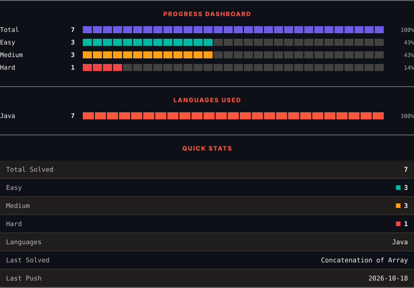
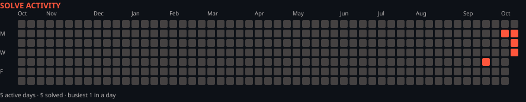

<h1>LeetCode Solutions</h1>

<em>Automatically synced with every accepted submission</em>

   

<picture>
  <source media="(prefers-color-scheme: dark)" srcset=".leetsync/stats-dark.svg">
  <source media="(prefers-color-scheme: light)" srcset=".leetsync/stats-light.svg">
  
</picture>

<picture>
  <source media="(prefers-color-scheme: dark)" srcset=".leetsync/calendar-dark.svg">
  <source media="(prefers-color-scheme: light)" srcset=".leetsync/calendar-light.svg">
  
</picture>

---

### ALL SOLUTIONS

| # | Problem | Difficulty | Language | Date |
|:---:|:--------|:----------:|:--------:|:----:|
| 2 | [Add Two Numbers](problems/0002-Add-Two-Numbers) | 🟧 Medium | `Java` | 2026-09-24 |
| 151 | [Reverse Words in a String](problems/0151-Reverse-Words-in-a-String) | 🟧 Medium | `Java` | 2026-10-14 |
| 153 | [Find Minimum in Rotated Sorted Array](problems/0153-Find-Minimum-in-Rotated-Sorted-Array) | 🟧 Medium | `Java` | 2026-10-13 |
| 154 | [Find Minimum in Rotated Sorted Array II](problems/0154-Find-Minimum-in-Rotated-Sorted-Array-II) | 🟥 Hard | `Java` | 2026-10-12 |
| 344 | [Reverse String](problems/0344-Reverse-String) | 🟩 Easy | `Java` | 2026-10-14 |
| 704 | [Binary Search](problems/0704-Binary-Search) | 🟩 Easy | `Java` | 2026-10-05 |
| 1929 | [Concatenation of Array](problems/1929-Concatenation-of-Array) | 🟩 Easy | `Java` | 2026-10-18 |

---

Auto-synced by <strong>LeetSync</strong> · Built by <a href="https://deveshsamant.in/">Devesh Samant</a>

