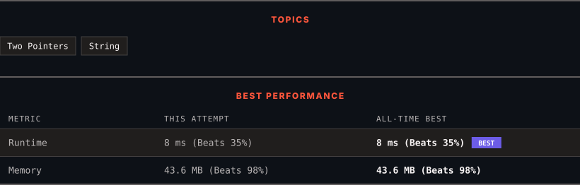

<div align="center">

# 151. Reverse Words in a String

      

[](https://leetcode.com/problems/reverse-words-in-a-string/)

</div>

---

<div align="center">

<picture>
  <source media="(prefers-color-scheme: dark)" srcset="panel-dark.svg">
  <source media="(prefers-color-scheme: light)" srcset="panel-light.svg">
  
</picture>

</div>

> **New personal best** — Runtime improved on this submission.

### HOW IT WENT

| | |
|:--|:--|
| **Attempts** | first try |
| **Time to solve** | 5 min |
| **Verdicts** | ✅ Accepted |

---

### NOTES

_No notes yet._

---

### SOLUTIONS (1)

| # | File | Language | Date |
|:-:|------|:--------:|:----:|
| 1 | [sol1.java](./sol1.java) | `Java` | 2026-10-14 ← **latest** |

---

### PROBLEM DESCRIPTION

Given an input string `s`, reverse the order of the **words**.

A **word** is defined as a sequence of non-space characters. The **words** in `s` will be separated by at least one space.

Return *a string of the words in reverse order concatenated by a single space.*

**Note** that `s` may contain leading or trailing spaces or multiple spaces between two words. The returned string should only have a single space separating the words. Do not include any extra spaces.

 

**Example 1:**

```

**Input:** s = "the sky is blue"
**Output:** "blue is sky the"

```

**Example 2:**

```

**Input:** s = "  hello world  "
**Output:** "world hello"
**Explanation:** Your reversed string should not contain leading or trailing spaces.

```

**Example 3:**

```

**Input:** s = "a good   example"
**Output:** "example good a"
**Explanation:** You need to reduce multiple spaces between two words to a single space in the reversed string.

```

 

**Constraints:**

	- `1 <= s.length <= 10^4`

	- `s` contains English letters (upper-case and lower-case), digits, and spaces `' '`.

	- There is **at least one** word in `s`.

 

**Follow-up: **If the string data type is mutable in your language, can you solve it **in-place** with `O(1)` extra space?

---

<div align="center">

<sub>Auto-synced by <strong>LeetSync</strong> · Built by <a href="https://deveshsamant.in/">Devesh Samant</a></sub>

</div>
