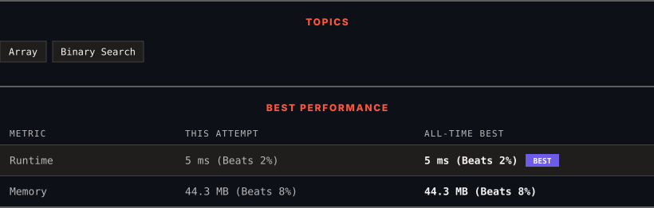

<div align="center">

# 153. Find Minimum in Rotated Sorted Array

      

[](https://leetcode.com/problems/find-minimum-in-rotated-sorted-array/)

</div>

---

<div align="center">

<picture>
  <source media="(prefers-color-scheme: dark)" srcset="panel-dark.svg">
  <source media="(prefers-color-scheme: light)" srcset="panel-light.svg">
  
</picture>

</div>

> **New personal best** — Runtime improved on this submission.

### HOW IT WENT

| | |
|:--|:--|
| **Attempts** | first try |
| **Time to solve** | 2 min |
| **Verdicts** | ✅ Accepted |

---

### NOTES

_No notes yet._

---

### SOLUTIONS (1)

| # | File | Language | Date |
|:-:|------|:--------:|:----:|
| 1 | [sol1.java](./sol1.java) | `Java` | 2026-10-13 ← **latest** |

---

### PROBLEM DESCRIPTION

Suppose an array of length `n` sorted in ascending order is **rotated** between `1` and `n` times. For example, the array `nums = [0,1,2,4,5,6,7]` might become:

	- `[4,5,6,7,0,1,2]` if it was rotated `4` times.

	- `[0,1,2,4,5,6,7]` if it was rotated `7` times.

Notice that **rotating** an array `[a[0], a[1], a[2], ..., a[n-1]]` 1 time results in the array `[a[n-1], a[0], a[1], a[2], ..., a[n-2]]`.

Given the sorted rotated array `nums` of **unique** elements, return *the minimum element of this array*.

You must write an algorithm that runs in `O(log n) time`.

 

**Example 1:**

```

**Input:** nums = [3,4,5,1,2]
**Output:** 1
**Explanation:** The original array was [1,2,3,4,5] rotated 3 times.

```

**Example 2:**

```

**Input:** nums = [4,5,6,7,0,1,2]
**Output:** 0
**Explanation:** The original array was [0,1,2,4,5,6,7] and it was rotated 4 times.

```

**Example 3:**

```

**Input:** nums = [11,13,15,17]
**Output:** 11
**Explanation:** The original array was [11,13,15,17] and it was rotated 4 times. 

```

 

**Constraints:**

	- `n == nums.length`

	- `1 <= n <= 5000`

	- `-5000 <= nums[i] <= 5000`

	- All the integers of `nums` are **unique**.

	- `nums` is sorted and rotated between `1` and `n` times.

---

<div align="center">

<sub>Auto-synced by <strong>LeetSync</strong> · Built by <a href="https://deveshsamant.in/">Devesh Samant</a></sub>

</div>
