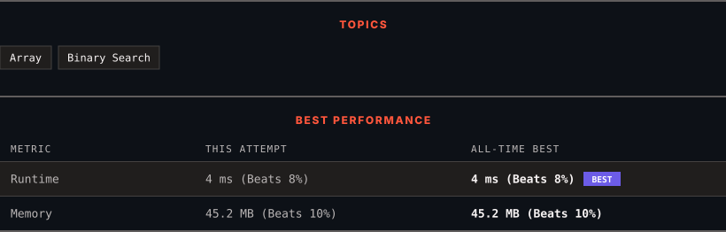

<div align="center">

# 154. Find Minimum in Rotated Sorted Array II

      

[](https://leetcode.com/problems/find-minimum-in-rotated-sorted-array-ii/)

</div>

---

<div align="center">

<picture>
  <source media="(prefers-color-scheme: dark)" srcset="panel-dark.svg">
  <source media="(prefers-color-scheme: light)" srcset="panel-light.svg">
  
</picture>

</div>

> **New personal best** — Runtime improved on this submission.

### HOW IT WENT

| | |
|:--|:--|
| **Attempts** | first try |
| **Time to solve** | 1 min |
| **Verdicts** | ✅ Accepted |

---

### NOTES

_No notes yet._

---

### SOLUTIONS (1)

| # | File | Language | Date |
|:-:|------|:--------:|:----:|
| 1 | [sol1.java](./sol1.java) | `Java` | 2026-10-12 ← **latest** |

---

### PROBLEM DESCRIPTION

Suppose an array of length `n` sorted in ascending order is **rotated** between `1` and `n` times. For example, the array `nums = [0,1,4,4,5,6,7]` might become:

	- `[4,5,6,7,0,1,4]` if it was rotated `4` times.

	- `[0,1,4,4,5,6,7]` if it was rotated `7` times.

Notice that **rotating** an array `[a[0], a[1], a[2], ..., a[n-1]]` 1 time results in the array `[a[n-1], a[0], a[1], a[2], ..., a[n-2]]`.

Given the sorted rotated array `nums` that may contain **duplicates**, return *the minimum element of this array*.

You must decrease the overall operation steps as much as possible.

 

**Example 1:**

```
**Input:** nums = [1,3,5]
**Output:** 1

```

**Example 2:**

```
**Input:** nums = [2,2,2,0,1]
**Output:** 0

```

 

**Constraints:**

	- `n == nums.length`

	- `1 <= n <= 5000`

	- `-5000 <= nums[i] <= 5000`

	- `nums` is sorted and rotated between `1` and `n` times.

 

**Follow up:** This problem is similar to [Find Minimum in Rotated Sorted Array](https://leetcode.com/problems/find-minimum-in-rotated-sorted-array/description/), but `nums` may contain **duplicates**. Would this affect the runtime complexity? How and why?

---

<div align="center">

<sub>Auto-synced by <strong>LeetSync</strong> · Built by <a href="https://deveshsamant.in/">Devesh Samant</a></sub>

</div>
