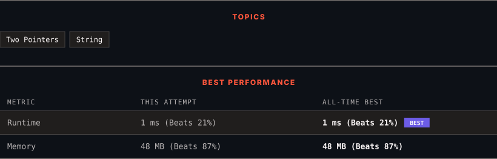

<div align="center">

# 344. Reverse String

      

[](https://leetcode.com/problems/reverse-string/)

</div>

---

<div align="center">

<picture>
  <source media="(prefers-color-scheme: dark)" srcset="panel-dark.svg">
  <source media="(prefers-color-scheme: light)" srcset="panel-light.svg">
  
</picture>

</div>

> **New personal best** — Runtime improved on this submission.

### HOW IT WENT

| | |
|:--|:--|
| **Attempts** | first try |
| **Time to solve** | 3 min |
| **Verdicts** | ✅ Accepted |

---

### NOTES

_No notes yet._

---

### SOLUTIONS (1)

| # | File | Language | Date |
|:-:|------|:--------:|:----:|
| 1 | [sol1.java](./sol1.java) | `Java` | 2026-10-14 ← **latest** |

---

### PROBLEM DESCRIPTION

Write a function that reverses a string. The input string is given as an array of characters `s`.

You must do this by modifying the input array [in-place](https://en.wikipedia.org/wiki/In-place_algorithm) with `O(1)` extra memory.

 

**Example 1:**

```
**Input:** s = ["h","e","l","l","o"]
**Output:** ["o","l","l","e","h"]

```

**Example 2:**

```
**Input:** s = ["H","a","n","n","a","h"]
**Output:** ["h","a","n","n","a","H"]

```

 

**Constraints:**

	- `1 <= s.length <= 10^5`

	- `s[i]` is a [printable ascii character](https://en.wikipedia.org/wiki/ASCII#Printable_characters).

---

<div align="center">

<sub>Auto-synced by <strong>LeetSync</strong> · Built by <a href="https://deveshsamant.in/">Devesh Samant</a></sub>

</div>
